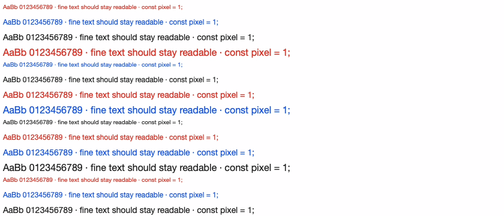

# Quality, motion and access milestone — 2026-11-03

## Status

Framecraft v0.3 has a working native capture/edit/export foundation. It is not at demonstrated Shotbase/Screen Studio parity. Native capture and a controlled synthetic output test are now verified; a matched competitor export is still unverified.

## Access failure

The running v0.2 app returned “The user declined TCCs for application, window, display capture” while System Settings showed Framecraft enabled. Its ad-hoc code-signing designated requirement was a binary hash. A rebuilt binary can differ from the settings-authorized build. No valid local code-signing identity was installed. Broad-permission error handling also mislabeled unrelated failures.

v0.3 uses SCContentSharingPicker instead of enumerating the full desktop. The person explicitly chooses a window/display and macOS authorizes that source for the session. This is Apple's intended route, not a weakened security requirement. [Apple WWDC privacy guidance](https://developer.apple.com/videos/play/wwdc2023/10053/) and [ScreenCaptureKit](https://developer.apple.com/documentation/screencapturekit).

The user completed source selection and started a recording. Framecraft finalized a 66.363s HEVC file at 3024×1654, with one audio track, 7,943 pointer samples, and zero writer-backpressure frame drops. The source was largely static and the raw track had a very sparse nominal frame rate (~0.03). This test verifies the picker/encoder/finalization path, not 60 unique content updates per second, audio synchronization, or performance on a long moving 5K screen. Private capture pixels and project data are not in this repository.

## Output changes

- Capture dimensions come from filter contentRect × pointPixelScale. The old assumed 2× scaling and silent 4K cap are removed. Native 5120×2880 sizing is covered by a check; no live 5K capture has been tested.
- Explicit H.264 High/CABAC, HEVC Main and ProRes 4444 profiles replace the opaque export preset. ProRes is a large-file SDR editing master, not mathematically lossless and not an HDR implementation.
- Compact capture/exports use explicit YCbCr surfaces; masters retain RGB. A first attempt passing RGB directly into the compact encoders produced substantial chroma aliasing on a one-pixel alternating-color target. Explicit YCbCr output corrected that measured regression. VideoToolbox's [chroma downsampling options](https://developer.apple.com/documentation/videotoolbox/downsampling-mode-constants) were also investigated; setting the compression subproperty alone did not fix the observed RGB path.
- Preview/export uses one combined spatial scale with Lanczos resampling for camera plus framing, instead of two successive resize stages. Upscaling cannot recreate missing source detail.
- Source audio is mixed into the trimmed export. Export progress/cancel and source-preserving temporary-file replacement are implemented.

## Motion changes

| Before | After |
| --- | --- |
| Baked-in cursor | Optional new-recording pointer sidecar sampled at 120Hz, smoothed offline with a symmetric 24ms Gaussian, rendered as a high-resolution arrow |
| Original source frame timing governs camera motion | Composition runs at 60fps, independent of sparse static-screen source frames |
| Latest active zoom wins abruptly | Overlapping camera transforms blend continuously with quintic easing |
| Slider updates recreate composition | Shared render state updates parameters; seeking is coalesced |
| UI playhead updates at 20Hz | 60Hz playhead observer; numeric values retain tabular widths |
| Generic permission error / unclear recording state | Native source selection, specific error details, source summary and recording timer |

The arrow overlay is intentional scope: text-selection/resize/custom cursor shapes are not reconstructed. Turn smoothing off to capture original system cursor shapes. Earlier videos with a baked cursor cannot be smoothed or removed. Click events/effects, automated zoom suggestions, motion blur and shape-aware cursor tracks are future work. Window movement uses stream screen-rect updates; window resizing, mixed-DPI displays and pointer edge behavior need additional manual validation. Source and raw video sidecar must stay together until export.

## Synthetic measurement

Reproduce with `swift run ... FramecraftQuality /tmp/framecraft-quality` (cache/sandbox flags are the same as README). It generates a 1920×1080, 60fps, two-second ProRes 4444 reference containing 10–16px monochrome/colored text, single-pixel patterns, gray ramps and motion. Candidates use identical dimensions and no framing/zoom. Scores compare four exact-time decoded frames to the decoded source, in sRGB. Text ROI is x=35,y=75,w=840,h=600. Higher PSNR is better; this does not measure perceived quality, OCR accuracy, HDR, live capture, or competitor quality.

| Profile | RGB PSNR | Text ROI PSNR | Actual bitrate | Presented samples |
| --- | ---: | ---: | ---: | ---: |
| Previous highest-quality preset | 37.07 dB | 32.05 dB | 2.72 Mb/s | 120 |
| H.264 high | 37.34 dB | 32.17 dB | 1.62 Mb/s | 120 |
| HEVC high | 37.45 dB | 32.21 dB | 1.97 Mb/s | 120 |
| ProRes 4444 master | 42.52 dB | 42.46 dB | 330.07 Mb/s | 120 |

The compact-profile improvement is modest. The master improves this text-detail stress-test score substantially at a very large storage cost. These bitrates are measured for this content, not promised file sizes or the requested encoder budget. All sorted presentation-time gaps are ~16.67ms. An early diagnostic incorrectly treated B-frame decode order as presentation order; that measurement was corrected and is not used here. Legacy media timestamps include an encoder offset; the report retains first/last PTS and asset duration.

Full machine-readable results: [report JSON](quality-assets/2026-11-03-report.json).

Reference crop (840×360 at source pixel size):

H.264 crop:

ProRes 4444 master crop:

## REA investigation

Used REA CLI 6.8.0 on installed Shotbase 1.7.1. Retained actual REA outputs:

- Desktop inventory parent Evidence `ev_707b6cf670e776d7af7455b69088c25f772152f7f77a4a63a1bfccb488f14c67` — 213 examined entries; bounded metadata/header observations, not a hash of every full file. [Inventory](evidence/shotbase-desktop.json)
- Plist Evidence `ev_9b6202443346b7387b6e73dce98d08b02693d7a8aef7929ac5b16acd6a8b3720` — exact bundle metadata and registered image/movie document types. [Plist](evidence/shotbase-plist.json)
- Mach-O Evidence `ev_17a96a2fe757cf23e137cce711123a4cdf87b3687e4714b1f26204cb339d4a7b` — selected arm64 architecture; executable SHA-256 `270d7ebe9489589dfaccd992afcbb3fde384b7727cde056f2b569b068244e0cd`. [Mach-O](evidence/shotbase-macho.json)

Observed static dependencies include ScreenCaptureKit, AVFoundation, VideoToolbox, Core Image and Metal. Imported API names include AVAssetWriter/Input/PixelBufferAdaptor, H.264/HEVC codec constants, bitrate/quality/profile controls and color properties. This supports the hypothesis of a native capture/encoding/compositing pipeline similar in broad technology choice to ours. It does **not** reveal the actual settings used for any recording or the cursor/zoom algorithm. No native functions were decompiled or dynamically traced. CLI ran successfully with macOS native inspection utilities under the existing Node 25 runtime; that runtime is outside REA's declared supported Node engine range, a reproducibility limitation.

Shotbase's dashboard/static/Motion UI was observed live. Its capture selection overlay was not exposed reliably through the available UI-control surface, and no matched synthetic input/output was exported from it in this milestone. This remains an explicit open task.

## Checks and remaining gaps

Passed: native app build; continuous zoom/cursor math, native pixel sizing, short intervals, project/theme serialization/validation, palette contrast, 2560×1440/60fps eight-second demo decoding, trimmed 60fps export with audio track, cancellation cleanup and actual encode/decode calibration. A separate synthetic overlapping-zoom/pointer motion demo is generated locally by FramecraftQuality.

Still unverified: audio sync, long/high-motion/5K capture endurance, HDR/P3 preservation, all cursor shapes, window-resize/mixed-DPI edge cases, a matched Shotbase export, and subjective motion quality under a controlled side-by-side playback. A complete independent review was not available; this milestone was reviewed by its author.

## Final native UI check

The v0.3 release package was relaunched. The empty light editor and recording/project controls were observed through native accessibility. The existing edited project had been saved before quitting. Selecting that saved JSON through the native Open dialog succeeded in closing the panel, but subsequent UI-control calls timed out, including after a tool-session reset. A local process sample showed the app's main thread idle in its normal event loop, not a captured computation deadlock. This does not prove the restored preview rendered correctly. Final populated-preview invalidation and export-sheet visual checks remain incomplete pending UI access; do not treat automated media checks as substitutes.
